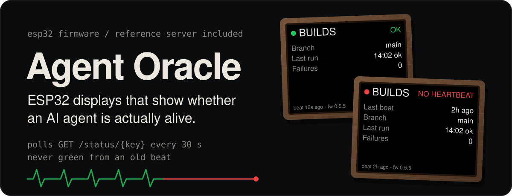
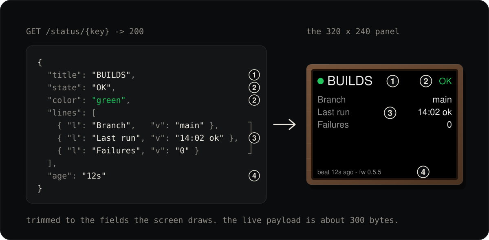
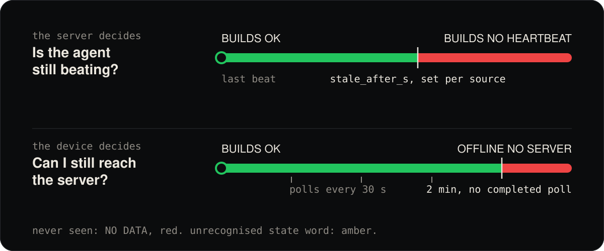

<p align="center">
  
</p>

This repo is the **renderer**. It polls a URL and draws whatever comes back, so
it needs a server that speaks the contract in
[docs/server-contract.md](docs/server-contract.md). A zero-dependency reference
server is included in [server/](server/) so the firmware does something the
moment you flash it. Swap it for your own once you know what you want on screen.

## Supported boards

| Environment | Panel | Chip | Notes |
|---|---|---|---|
| `esp32-2432S028R` | 2.8" 320×240 | ESP32 | "Cheap Yellow Display". Three revisions ship different display controllers |
| `esp32-2432S028Rv2`, `...v3` | same | ESP32 | Different display controllers |
| `esp32-4827S043C` | 4.3" 480×272 RGB | ESP32-S3 | PSRAM, full-frame buffer, pixel clock raised to stop 50Hz flicker |

**Do not infer your board revision from the hardware.** Ours have two USB ports
and are `esp32-2432S028R`, which is documented as the single-USB variant. Flash
and look: a photo-negative screen means the wrong environment, nothing is
damaged, try the next one. See [docs/board-revisions.md](docs/board-revisions.md).

## The design rule everything follows

**The device is dumb.** It polls `GET /status/{key}` and draws exactly what comes
back: a title, a state word, a colour, and up to five label/value lines. There is
no formatting logic, no thresholds and no agent-specific knowledge in this
firmware. Changing what a screen says is a one-file edit on the server, with no
rebuild, no OTA and no physical access.

<p align="center">
  
</p>

**Except one thing.** The server cannot tell you it is unreachable. If the device
cannot complete a poll for `OFFLINE_AFTER_MS` (2 minutes) it stops showing the
last payload and declares OFFLINE. A screen quietly displaying two-hour-old "all
good" is the exact failure this product exists to prevent, so that judgement is
device-side and must never be relaxed into "keep showing the last known state".

<p align="center">
  
</p>

**One screen can show several agents.** A device whose `agent` column names more
than one (`crons,motoko`) receives a list and cycles it. Order, dwell time,
whether to hold, and the group colour are all resolved server-side, so a unit
moves between one agent and a group with no reflash. A red screen stops the
rotation and parks there, because cycling past the thing that needs attention is
the failure that page navigation was rejected for.

## First build

```bash
pip install platformio
```

```bash
cp src/config.h.example src/config.h
```

Nothing device-specific goes in that file. Both the **server host** and the
**device key** are entered in the setup portal on first boot and stored in NVS,
so one binary serves every unit and an update never overwrites which agent a
screen shows. Register a device with:

```bash
cd server && node add-device.js "Desk — Vega" vega
```

Then flash the environment matching your board:

```bash
pio run -e esp32-2432S028R -t upload
```

If `pio` is not on your PATH, the console script may not be installed even
though the package is. Use the module directly, which is what `scripts/release.sh`
does:

```bash
python -m platformio run -e esp32-2432S028R -t upload
```

On first boot with no saved WiFi the device raises an open AP called
`AgentStatus-Setup` and serves a captive portal. That is also how a unit is
re-provisioned after a router password change, and a 5 second press on the screen
reopens it without a cable.

## Over-the-air updates

Working and demonstrated. The device fetches
`/firmware/manifest-<BOARD_NAME>.json` on boot and hourly, and installs only
strictly newer semantic versions.

```bash
scripts/release.sh esp32-2432S028R
```

That builds, uploads the binary, then publishes the manifest, in that order, so a
device polling mid-release either sees the old version or a manifest whose binary
already exists. The manifest is written to a temp file and moved into place,
because a device must never read a half-written one.

Three rules worth knowing before you touch any of it:

- **The manifest carries a sha256 and the device refuses to flash without one.**
  TLS proves you reached the right host; it says nothing about whether the bytes
  on that host are the ones that were built. Everything is written to the
  inactive app slot, so a mismatch, a truncated download or a stall discards the
  staged image and the unit keeps running what it has.
- **One manifest per board revision.** The revisions ship different display
  controllers, and a shared manifest can flash the wrong driver onto a unit,
  leaving a screen only a physical reflash recovers.
- **Updates only move forward.** A rollback needs an explicit
  `"allow_downgrade": true`, because a stale manifest once walked a
  freshly-flashed unit backwards and silently undid the flash.

Devices report `X-Firmware-Version` and `X-Board` on every poll, so the server
can tell you what each unit is running without anyone reading it off a screen.

## What's in here

| Path | |
|---|---|
| `src/main.cpp` | poll loop, rendering, rotation, offline rule, OTA client |
| `src/config.h.example` | per-unit settings; copy to `config.h` (gitignored) |
| `include/lv_conf.h` | LVGL config, Montserrat 20/28 enabled |
| `include/root_ca.h` | pinned ISRG Root X1, so TLS is verified rather than merely encrypted |
| `boards/` | vendored board definitions, see `boards/README.md` |
| `server/` | zero-dependency reference server |
| `scripts/release.sh` | build and publish an OTA release |
| `enclosure/` | walnut case notes and STL fallbacks |

## Status

Running on three units, two 2.8" and one 4.3". Latest release is 0.5.5.

The over-the-air path has been exercised end to end, not just written: a device
fetched its manifest, downloaded the full 1.4MB image, verified the hash, wrote
the inactive slot, rebooted itself and reported the new version back to the
server.

Known limitations are listed honestly at the end of
[docs/decisions.md](docs/decisions.md), including the fact that the device key is
a bearer token and is not a basis for approvals.

## Why it's built this way

[docs/decisions.md](docs/decisions.md) records the decisions and what each one
cost to learn. Most exist because something failed on real hardware first, and
those are marked. Read it before changing the staleness rules, the partition
table, the memory overrides or the build flags.

[CHANGELOG.md](CHANGELOG.md) has the version history.

## Licence

MIT, see [LICENSE](LICENSE).
